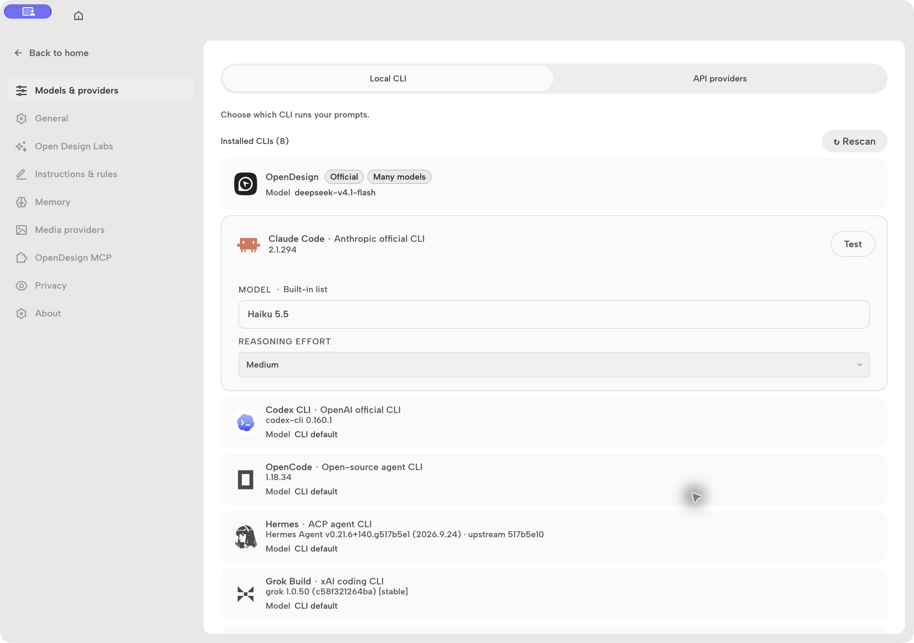
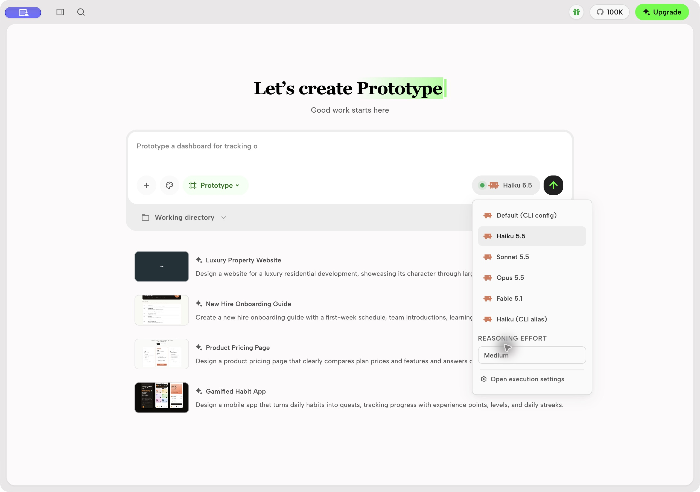

# Claude model picker and reasoning

Open Design offers explicit Claude model versions and model-specific reasoning effort
to the Local CLI settings and the chat model picker. Haiku 5.5, Sonnet 5.5,
Opus 5.5, and Fable 5.1 offer Low, Medium, High, Extra high, and Max. CLI default
omits `--effort`, preserving Claude Code's own settings. Legacy models hide
unsupported effort controls. CLI aliases, custom model IDs, and the "Default
(CLI config)" model offer the full effort list; Claude Code clamps a level the
model cannot use. Changing the model clears a saved effort the new model does
not offer. The chat picker's effort row appears for every Local CLI agent that
publishes effort options (for example Codex), not only Claude.

Claude Code must support the selected model and `--effort`; Haiku 5.5 requires
Claude Code 2.1.293 or newer. Open Design forwards the model ID and effort to
Claude Code, which handles account and provider availability. Effort is only
passed when the installed CLI's `--help` advertises `--effort`. If it does not,
or the probe cannot answer even after one retry, the run continues without
`--effort` and reports a `reasoning_effort_omitted` diagnostic. The
authoritative capability reference is [Claude Code model configuration](https://code.claude.com/docs/en/model-config).





The command-line entry point supports the same selection:

```sh
od run start --project <project-id> --agent claude \
  --model claude-haiku-5-5 --reasoning medium
```

The run-create response (and `--json` output) includes
`reasoning: { requested, applied, options }`. When the requested level is not
applied, because it is unknown or the model does not accept it, `od run start` and
`od run redesign` print a warning to stderr that lists the accepted levels.
